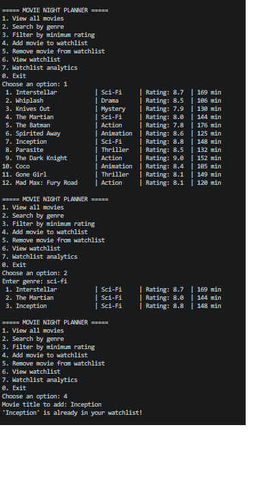
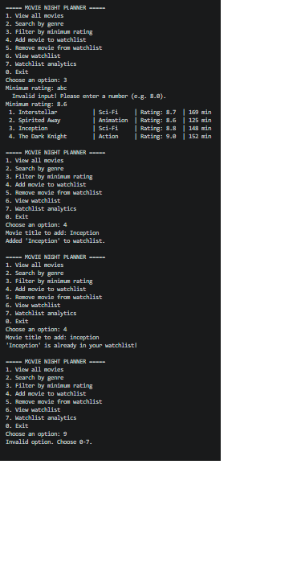

# Movie Night Planner

**Week 2: Advanced Python & Data Structures**

**IEEE LGU AI/ML Cohort One**

**AI/ML Leads: Abdullah Faisal & Alina Irshad**

## Project Overview
A command-line movie recommendation and watchlist manager. It loads a movie library from a CSV file, lets the user search and filter it, and builds a personal watchlist with duration and rating analytics.

## Concepts Implemented
- **OOP:** `Movie` and `Watchlist` classes with encapsulated data (`_movies`, `_titles`)
- **File Handling:** CSV read with `open()` / `with` and `csv.DictReader`
- **Error Handling:** `try/except` for letters typed instead of numbers, bad CSV rows, and a missing file
- **Data Structures:** list (movies), set (duplicate-proof watchlist titles)
- **Comprehensions:** list comprehensions for genre and rating filters

## How to Run
```bash
python main.py
```

## Dataset Information
`data/movies.csv` has **12 movies** (`title,genre,rating,duration`). Rows with an invalid rating or duration are skipped with a warning instead of crashing the program.

## Execution Screenshots & Proof
**Normal run:**



**Error handling test (letters instead of a number, duplicate movie, invalid option):**

